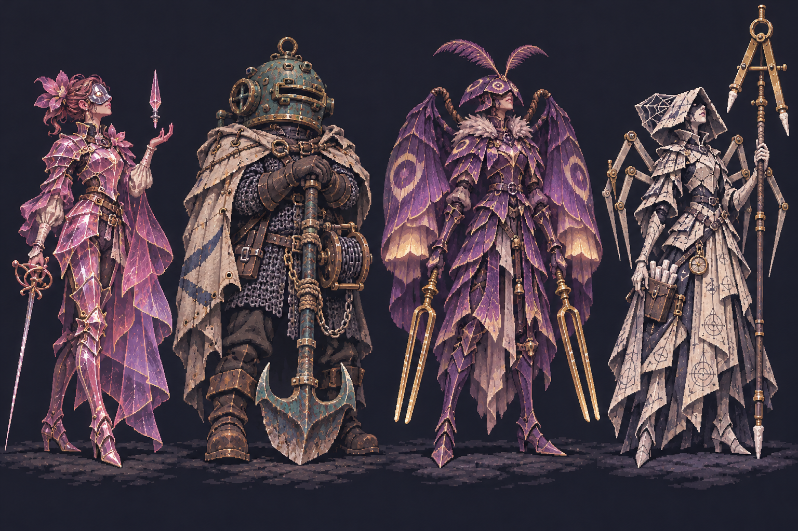
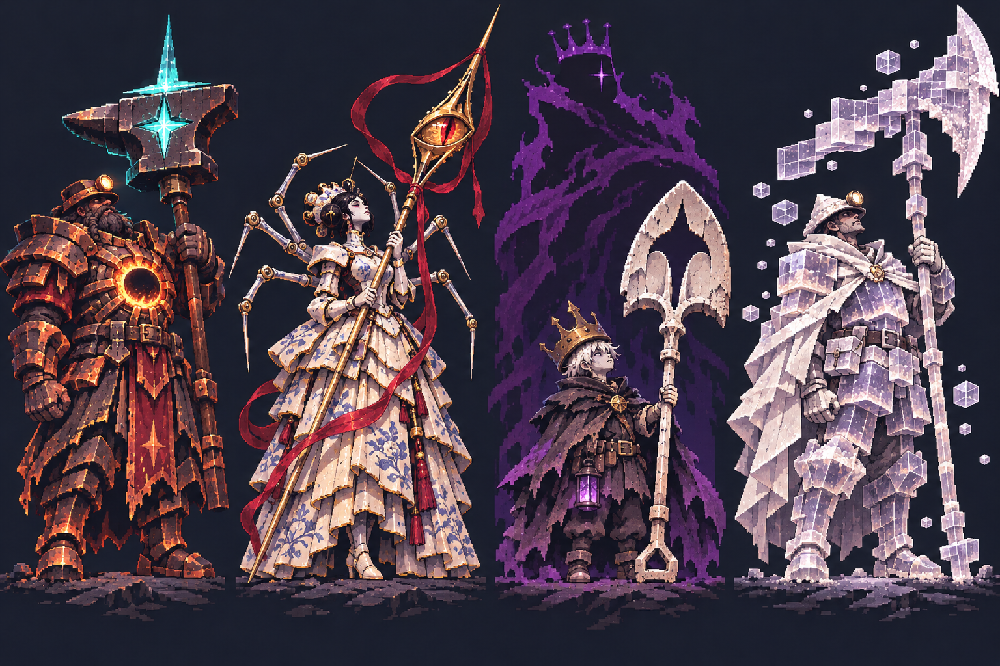
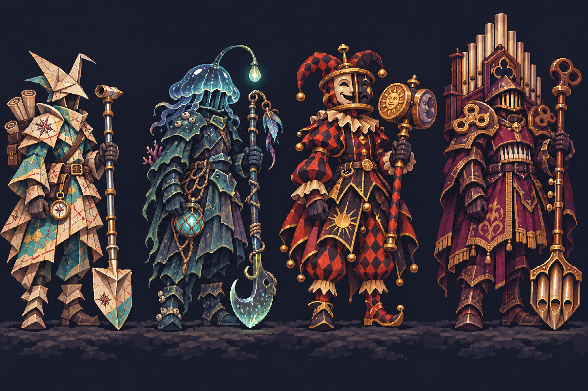

# Die neue Rüstkammer

Designübergabe für Claude auf Basis von [main bei cc0e638](https://github.com/wreckedangler/shovel/commit/cc0e6388ec3af3cfc514fa3f2f07c1aed1009cb7). Der [HTML-Katalog](Katalog.html) enthält zusätzlich die durchsuchbare Bestandsaufnahme mit 188 Einträgen. Er lässt sich lokal zusammen mit den drei Bildtafeln öffnen.

## Erwerb und Ausrüstung

50 neue Funde ergänzen den bestehenden Truhenpool von 129 auf 179. Die zwölf Sets und ihre Signaturwaffen haben eigene Fundwege. Jedes Set umfasst Helm, Brust, Umhang und Hose. Die vier Teile verwenden die Grundwerte ihrer jeweiligen Schmiedestufe. Zusammen aktivieren sie die Setfähigkeit. Die Waffe kann separat getragen werden.

Für die sieben Meisterduelle schaltet der erste Sieg das jeweilige Set zusätzlich zur bisherigen Erstbelohnung frei. Bereits gespeicherte Siege zählen rückwirkend. Die Waffenprüfung kann beim ersten Sieg erfüllt werden. Die Balancewerte sind Vorschläge für die Implementierung.

## Sets und Waffen

### Ornat der Glasrose

Sereia · Bossset

Rosa Glas über anthrazitfarbenem Stoff. Im Stand schwebt die abgebrochene Rapierspitze vor der Hand.

**Helm · Brust · Umhang · Hose** — Spiegelhalbmaske · Facettenkürass · Mantel aus Glasblättern · Rosengamaschen

**Setfähigkeit** — Nach einem Richtungswechsel in der Luft hinterlässt du für 0,45 s eine Glassilhouette. Ein gewöhnlicher Pfeil zerbricht daran. Abklingzeit 8 s.

**Rosenschliff · Waffe** — Der erste Stich setzt die lose Spitze hinter dem getroffenen Ziel ab. Der nächste Stich binnen 1,2 s zieht sie gerade zurück und trifft auf dem Rückweg einmal für 2 Schaden.

**Fundbedingung** — Besiege Sereia in einem Lauf, in dem keiner ihrer Rückstöße ihr Leben zurückgibt.

Bisheriger Erstfund: Siebenmeilenstiefel

### Lotse der Ebbe

Brunn · Bossset

Patinierte Taucherglocke mit einem einzigen Sehschlitz. Die Kette des zweizinkigen Ankers läuft über die rechte Schulter.

**Helm · Brust · Umhang · Hose** — Taucherglocke · Ballastweste · Rahsegel · Kettenstiefel

**Setfähigkeit** — Ducken am Boden wirft den Gürtelanker. Bis zum Loslassen widerstehst du horizontalem Sog, kannst aber weder laufen noch springen.

**Kielbrecher · Waffe** — Ein Bodenhieb legt den Anker aus. Der nächste Luftangriff zieht dich bis zu 48 Pixel zum Anker zurück. Er löst sich an der ersten Wand. Ein aktiver Anker.

**Fundbedingung** — Überstehe Brunns Springflut auf einem erhöhten Steg und gewinne denselben Kampf.

Bisheriger Erstfund: Drachenschuppenpanzer

### Vespergewand

Vesper · Bossset

Violette Mottenflügel hängen wie zwei aufgeschnittene Glocken. Die Waffe besteht aus zwei unterschiedlich langen Messingzinken.

**Helm · Brust · Umhang · Hose** — Fühlerreif · Klangbrust · Glockenschwingen · Samtstulpen

**Setfähigkeit** — Streift dich ein Schallring innerhalb von 8 Pixeln ohne Treffer, lädt sich ein Flügel. Zwei Ladungen erlauben 0,5 s Schweben beim Halten von Sprung. Danach leeren sich beide.

**Zwillingsstimme · Waffe** — Trifft zuerst der lange Zinken aus maximaler Reichweite, entsteht ein tiefer Ton. Trifft binnen 1 s der kurze aus der Nähe, löst er zwischen beiden Treffpunkten eine Resonanz für 3 Schaden aus.

**Fundbedingung** — Durchquere in Vespers zweiter Phase beide Ringe desselben Nachhalls ohne Treffer und beende das Duell.

Bisheriger Erstfund: Schwingen des Sturms

### Gewand der Durchschrift

Kreidewitwe · Bossset

Elfenbein auf Schiefergrau. Eingeklappte Zeichenbeine auf dem Rücken geben dem Helden eine achteckige Kontur.

**Helm · Brust · Umhang · Hose** — Radiermaske · Schiefertafel · Spinnenriss · Graphitstelzen

**Setfähigkeit** — Drei harte Landungen zeichnen ein Dreieck. Beim dritten Eckpunkt verlangsamt sein Inneres gewöhnliche Gegner 2 s lang. Höchstens ein Dreieck, Seiten maximal 96 Pixel.

**Blindzirkel · Waffe** — Ein Hieb setzt das Standbein des Zirkels in festen Boden. Der nächste Hieb zeichnet einen Halbkreis um diesen Punkt und trifft jedes Ziel einmal mit normalem Waffenschaden. Radius 24 Pixel.

**Fundbedingung** — Lass drei Marken einer Durchschrift an drei unterschiedlichen Stellen einschlagen und besiege die Witwe ohne eine dieser Marken zu berühren.

Bisheriger Erstfund: Blick der Leere

### Die tragbare Esse

Nadir · Bossset

Kupferplatten um einen schwarzen Sonnenkreis. Im hohlen Hammerkopf steht ein blauer Stern still, während der Hammer schwingt.

**Helm · Brust · Umhang · Hose** — Eklipsenvisier · Ofenherz · Schlackenmantel · Ambosssohlen

**Setfähigkeit** — Drei zerstörte gegnerische Geschosse heizen die Esse auf. Die nächste harte Landung stößt einen Ring aus, der weitere normale Geschosse im Umkreis von 32 Pixeln auflöst. Danach ist die Esse kalt.

**Sternamboss · Waffe** — Der erste Hieb schlägt einen Sternsplitter in den Boden. Ein Abpraller auf seinem Kopf schmiedet ihn für einen geraden Schuss frei. Maximal ein Splitter; Schuss verursacht 3 Schaden.

**Fundbedingung** — Besiege Nadir nach einer Supernova, bei der du sowohl die Bodenwelle als auch den verzögerten Funkenring unversehrt überstehst.

Bisheriger Erstfund: Mantel des Ewigen Königs

### Ornat der losen Naht

Nahtmutter · Bossset

Eine goldene Reparaturnaht durchzieht die glatte Maske. Sechs schwarze Faltarme tragen einen einzigen roten Seidenfaden.

**Helm · Brust · Umhang · Hose** — Porzellanlarve · Lackmieder · Sechsarmiger Schleier · Saumstiefel

**Setfähigkeit** — Nach dem Verlassen einer beweglichen Plattform hält ein sichtbarer Faden 0,7 s lang. Einmal Sprung und Abwärts gemeinsam zieht dich zu ihrem aktuellen Rand zurück. Nur ein Faden, 6 s Pause.

**Das letzte Öhr · Waffe** — Der erste Hieb näht einen gewöhnlichen Gegner fest, der zweite einen anderen. Entfernen sie sich mehr als 48 Pixel voneinander, reißt die Naht und beide nehmen 2 Schaden. Bei Bossen dienen nur Geländeanker als Gegenpunkt; keine Bewegungsblockade.

**Fundbedingung** — Löse in der zweiten Phase alle sechs Hände, ohne dass dich ein gespannter Faden trifft, und gewinne.

Bisheriger Erstfund: Blutpakt

### Hofstaat eines Schattens

Nullfürst · Bossset

Die Figur wirkt klein und fast schwarz. Ihr Schatten trägt eine mannshohe Krone. Ein weißes Schaufelblatt bleibt selbst im Dunkeln lesbar.

**Helm · Brust · Umhang · Hose** — Schiefe Messingkrone · Rußwams · Überlanger Wandschatten · Lautlose Sohlen

**Setfähigkeit** — Beim Ducken bleibt der Schatten einen Takt stehen. Verfehlst du danach einen Nahkampfangriff, übernimmt der Schatten dessen Pose und zieht für 0,6 s einen normalen Gegner an. 5 s Pause.

**Elfenbein der Stille · Waffe** — Ein Abpraller zeichnet seinen Auftreffpunkt auf. Nach zwei sichtbaren Takten fällt dort eine Schattenklinge für 3 Schaden, falls du den markierten Streifen verlassen hast. Ein Echo gleichzeitig.

**Fundbedingung** — Besiege den Fürsten und triff ihn in der stummen Phase mit Schatten-Abprallern an drei verschiedenen Bodenpositionen, mindestens 32 Pixel auseinander.

Bisheriger Erstfund: Läufe des Knochenkönigs

### Habit der Salzheiligen

Salzgewölbe · Geheimset

Milchige Würfel schweben über einer Schulter. Die breite Hellebarde endet in einer quadratischen Kristalltreppe.

**Helm · Brust · Umhang · Hose** — Würfelkrone · Salzgitter · Schollenkragen · Kristallschienen

**Setfähigkeit** — Nach 1 s regungslosem Ducken wächst vor dir eine Salzstufe. Sie trägt einen Sprung und fällt danach in weiße Würfel. Eine Stufe gleichzeitig, 6 s Pause.

**Stufenhalit · Waffe** — Jeder dritte Bodenhieb lässt einen Salzkristall an der Kante des nächsten Erdblocks wachsen. Ein Seitenhieb splittert ihn in drei kurze Fächer; pro Ziel höchstens 2 Zusatzschaden.

**Fundbedingung** — Set: Sammle die drei Münzen der Goldader in einem Lauf. Waffe: Lege drei neue Salzadern in den Wurzelhöhlen von drei verschiedenen Seiten frei und berühre den weißen Schlussstein. Die Adern sind neue Kartenobjekte.

### Tracht des Randzeichners

Faltenatlas · Geheimset

Eine türkise Landkarte faltet sich beim Sprung zu einem Kranich. Das Blatt der Schaufel klappt entlang roter Höhenlinien aus.

**Helm · Brust · Umhang · Hose** — Kranichhaube · Kartenweste · Fächerumhang · Falzgamaschen

**Setfähigkeit** — Nach 2 s Stillstand erhält der nächste Absprung eine Falte. Einmal in der Luft umkehren verbraucht sie und stoppt den horizontalen Schwung sofort.

**Meridian · Waffe** — Ein Hieb speichert eine horizontale Falte. Der nächste Hieb von einer höheren Plattform öffnet das Blatt nach unten und trifft entlang einer 32 Pixel langen Senkrechten.

**Fundbedingung** — Set: Enthülle die Geheimtüren nach 1-G, 2-G und 3-G. Waffe: Stemple in einem Lauf drei zusätzliche Kartenpressen in 2-1 in der Reihenfolge Tief–Hoch–Mitte und erreiche das Ziel.

### Kanzel der Laternenfische

Tiefsee · Geheimset

Ein einzelner gelber Köder hängt vor einem nachtblauen Glashelm. Die Schaufel hat einen sichelförmigen Haken.

**Helm · Brust · Umhang · Hose** — Taucherglas · Schwarzstromkürass · Kiemenschleier · Flossenhose

**Setfähigkeit** — Eine ruhende Köderlampe lenkt den nächsten einzelnen Schuss eines normalen Fernkämpfers auf ihren letzten Standort. Sie erlischt 8 s. Zielen und Köder sind als zwei Lichtpunkte sichtbar.

**Ködermond · Waffe** — Ein Fehlschlag setzt den Köder für 2 s in die Luft. Ein zweiter Hieb holt ihn ein und zieht ein getroffenes normales Flugwesen bis zu 24 Pixel heran.

**Fundbedingung** — Set: Beende Q-2 mit genau einer eingesammelten Münze. Waffe: Locke in der Leuchtgrotte drei verschiedene Fernkämpfer-Schüsse in ein neues erloschenes Laternenmaul und entzünde es damit. Normale Umgebungsschüsse zählen ebenfalls.

### Der falsche Direktor

Schwarzer Jahrmarkt · Geheimset

Das Lächeln sitzt auf der Rückseite des Kopfes. Der Hammer besteht aus einer aufrecht stehenden rotgoldenen Münze.

**Helm · Brust · Umhang · Hose** — Doppelmaske · Frackpanzer · Karofahne · Lackgamaschen

**Setfähigkeit** — Beim Wenden wechselt die Maske. Rot verkürzt die erste Landepause, Gold verlängert den nächsten ununterbrochenen Lauf um einen kleinen Temposchub. Jeder Effekt frühestens alle 4 s.

**Kopf oder Zahl · Waffe** — Seitenhiebe drehen den Münzkopf auf Rot und treffen schmal, Abpraller drehen ihn auf Gold und treffen breit. Dreimal sauber abwechseln erzeugt beim dritten Treffer eine Münzwelle für 2 Zusatzschaden.

**Fundbedingung** — Set: Erreiche drei verschiedene Fahnenspitzen. Waffe: Gewinne ein neues Jahrmarkt-Minispiel mit fünf angekündigten Kopf/Zahl-Schlägen in richtiger Reihenfolge. Jeder Schlag verlangt eine sichtbare Eingabe statt einer Zufallswette.

### Der letzte Organist

Orgelwerk · Geheimset

Orgelpfeifen ragen über den Helm. Ein bordeauxroter Stoffbalg zieht sich beim Landen zusammen. An der Waffe sitzen drei echte Registerzüge.

**Helm · Brust · Umhang · Hose** — Pfeifenkranz · Blasebalg · Registerschleppe · Pedalstiefel

**Setfähigkeit** — Laufen, Springen und Landen füllen je ein Register. Sind alle drei voll, macht Ducken den nächsten Bodenwerfer für 1 s stumm. Keine Wirkung auf Bossangriffe.

**Dreiregister · Waffe** — Bodenhieb, Luftstich und Abpraller spielen drei verschiedene Töne. In dieser Reihenfolge entsteht ein Akkord, der normale Gegner für 0,4 s unterbricht. 5 s Pause; leuchtende Tasten zeigen die Folge.

**Fundbedingung** — Set: Besiege Vesper und das Pendelwerk. Waffe: Spiele in der Glockengruft den auf drei neuen Pfeifen eingravierten Rhythmus durch Hiebe und Landungen nach; falscher Takt startet nur die Phrase neu.

## Die 50 neuen Truhenfunde

Bei Relikten bezeichnen drei Werte die Stufen I, II und III.

### Relikt

| Fund | Seltenheit | Design | Wirkung |
|---|---|---|---|
| Kieselpendel | Gewöhnlich | Zwei graue Kiesel an türkisem Garn. | Nach 3 s Stillstand zeigt der untere Stein für 1/2/3 s zur nächsten ungesammelten Schaufelmünze. |
| Krümelsieb | Gewöhnlich | Ein verbeultes Messingsieb mit rotem Griff. | Jeder 8./6./4. selbst gegrabene Erdblock hinterlässt einen Krümel, der beim Aufheben 2 Rausch gibt. |
| Stiefelkreide | Gewöhnlich | Weißer Keil im blauen Papiermantel. | Markiert die letzten 3/5/7 betretenen Plattformen. Die älteste Marke verblasst zuerst. |
| Taschenlot | Gewöhnlich | Schwarzer Tropfen an gelber Schnur. | Beim Stillstehen am Rand zeigt eine Punktlinie die erste Landefläche bis 3/5/7 Blöcke tiefer. |
| Grubenfink | Gewöhnlich | Ein gelber Vogel aus gefaltetem Blech. | Zirpt 0,3/0,5/0,7 s vor dem nächsten Schuss eines sichtbaren Wandwerfers. |
| Flickmarke | Selten | Kupferplättchen, quer mit Garn umwickelt. | Die erste neu entzündete Laterne heilt 1/2/3 Herzen. Einmal pro Lauf. |
| Sporenstempel | Selten | Pilzhut auf einem violetten Holzgriff. | Die erste Pilzlandung markiert den nächsten normalen Gegner am Pilz für 3/5/7 s. Der erste Hieb auf ihn gibt 5 Rausch. |
| Wickelfeder | Selten | Ein flacher Ring aus blau angelaufenem Stahl. | Drei Bodenhiebe ohne Ortswechsel laden den nächsten Sprung auf. Er trägt 8/12/16 Pixel weiter in Blickrichtung. |
| Falscher Fünfer | Selten | Durchlochte Münze mit aufgemaltem Auge. | Die erste geöffnete Leveltruhe lockt gewöhnliche Gegner für 1/2/3 s zur Truhe. |
| Gleisbremse | Selten | Rostroter Bremsklotz mit zwei weißen Rillen. | Beim Loslassen der Lauftaste sinkt der Bremsweg auf Eis um 30/50/70 %. |
| Atemperle | Selten | Eine einzelne Luftblase in schwarzem Glas. | Nach 3 s ohne Angriff verlängert sich das Eingabefenster für den nächsten Sprung vom Plattformrand um 3/5/7 Frames. |
| Schlagzeiger | Episch | Winziges Zifferblatt mit nur einem Rubinzeiger. | Nach einem Treffer auf einen Gegner zeigt ein Ring das Ende seiner Trefferimmunität. Ein passend getimter Folgeangriff gibt 3/5/7 Rausch. |
| Landeflasche | Episch | Eine halbvolle Phiole mit schräger Wasserlinie. | Die erste harte Landung nach mindestens vier Blöcken Fallhöhe fängt eine Ladung. Der nächste Bodenhieb schiebt normale Gegner 12/20/28 Pixel zurück. |
| Knotenbuch | Episch | Drei Seiten, jede durch eine andere Öse genäht. | Jede dritte neu entdeckte Kampagnenlaterne trägt ein verschlossenes Lesezeichen mit 10/16/22 Edelsteinen. Ein Fund pro Laterne und Spielstand. |
| Ausweichgroschen | Episch | Bronzescheibe mit fehlendem Viertel. | Ein feindlicher Pfeil, der dich um höchstens 8 Pixel verfehlt, gibt 3/5/7 Rausch. Einmal je Geschoss, 2 s Pause. |
| Glasnegativ | Episch | Ein blauer Glasrahmen mit weißem Fußabdruck. | Beim ersten Treffer pro Raum bleibt ein stiller Doppelgänger zurück und bindet normale Verfolger für 0,6/0,9/1,2 s. Er verursacht keinen Schaden. |
| Sternschraube | Episch | Korkenzieher mit eingeklemmtem Stern. | Ein dritter Luftabpraller auf drei verschiedene Ziele zieht nahe Beute einmalig aus 64/96/128 Pixeln heran. |
| Notausgang | Legendär | Messingtürchen an einer Halskette. | Einmal pro Level öffnet langes Ducken an einer bereits entzündeten Laterne den Rückweg zur vorherigen. Das Fenster bleibt 2/4/6 s offen. |
| Nachtschichtkarte | Legendär | Schwarzer Karton mit drei phosphorgrünen Löchern. | Die ersten 1/2/3 zerstörten gegnerischen Geschosse pro Level hinterlassen einen Lichtkreis, der 4 s lang Fallen beleuchtet. |
| Letzter Applaus | Legendär | Zwei silberne Hände in einer Streichholzschachtel. | Besiegst du einen Gegner mit genau einem Herz, friert sein letzter Schuss für 12/18/24 Frames ein. Einmal pro Gegner. |

### Helm

| Fund | Seltenheit | Design | Wirkung |
|---|---|---|---|
| Rußbrille | Gewöhnlich | Zwei verschieden große rote Gläser vor einer Lederkappe. | Beim Graben wird die Staubwolke um den Kopf durchsichtig. Sichtbarer Vorteil in engen Gängen. |
| Schachtspiegel | Selten | Ein kleiner Spiegel hängt über dem linken Auge. | Ein Randpfeil zeigt den nächsten feindlichen Flugkörper hinter deinem Rücken innerhalb von 80 Pixeln. |
| Kamm der Libelle | Episch | Drei durchsichtige Facetten stehen senkrecht wie Segel. | Beim Absprung färbt sich die mittlere Facette, solange ein Luftsprung verfügbar ist. Der erste verbrauchte Luftsprung je Lauf gibt 8 Rausch. |

### Brust

| Fund | Seltenheit | Design | Wirkung |
|---|---|---|---|
| Fährmannsweste | Gewöhnlich | Eine rote Korkreihe über dunkelblauem Leinen. | Wer 2 s auf derselben beweglichen Plattform mitfährt, erhält 3 Rausch. Einmal je Plattform. |
| Schubladenpanzer | Selten | Schmale Holzfächer mit winzigen Porzellanknäufen. | Die erste aufgehobene Heilfrucht bei vollen Herzen wird gespeichert und beim nächsten echten Treffer für ein Herz verbraucht. |
| Scherbenarchiv | Legendär | In jeder schwarzen Schuppe steckt ein Stück Fensterglas. | Drei verschiedene zerstörte feindliche Geschosse laden eine Glasscherbe. Der nächste Seitenhieb feuert sie für 2 Schaden ab. |

### Umhang

| Fund | Seltenheit | Design | Wirkung |
|---|---|---|---|
| Band des Vermessers | Gewöhnlich | Gelbes Maßband, das beim Fallen senkrecht ausrollt. | Bei mehr als drei Blöcken Fallhöhe erscheinen Landepunkte unter den Füßen. |
| Flüsterfilz | Selten | Ein grauer Mantel voller gestickter Fledermausohren. | Nach 1 s Ducken reagiert der nächste gewöhnliche Gegner erst, wenn du dich wieder bewegst oder angreifst. |
| Vorhang der Pause | Episch | Ein halber Theatervorhang an goldener Querstange. | Nach 2 s Stillstand hinterlässt dein erster Sprung einen Vorhang, der genau einen normalen Pfeil auffängt. 12 s Abklingzeit. |

### Hose

| Fund | Seltenheit | Design | Wirkung |
|---|---|---|---|
| Lehmstulpen | Gewöhnlich | Breite, gestreifte Tonmanschetten an den Knöcheln. | Eine Landung auf Erde zeichnet für 3 s den angrenzenden Erdblock mit einem Riss nach. |
| Schienenläufer | Selten | Zwei kurze Schienen unter den Sohlen. | Beim Verlassen einer fahrenden Plattform bleibt ihr horizontaler Schwung für 0,3 s erhalten. |
| Bocksprungbund | Episch | Geflochtene rote Bänder um zwei bronzene Kniekappen. | Nach dem Überspringen eines lebenden normalen Gegners gibt die nächste Landung 6 Rausch. Einmal je Gegner. |

### Waffe

| Fund | Seltenheit | Design | Wirkung |
|---|---|---|---|
| Ziegelzunge | Gewöhnlich | Ein Maurerkellenblatt mit einer schiefen Zahnkante. | Zwei Hiebe auf denselben Erdblockplatz schieben beim zweiten Hieb den direkt dahinterliegenden Erdblock auf. Reichweite +1 Block nur für Erde. |
| Korkenzieherlanze | Selten | Weinrote Spirale um eine Messingachse. | Drei Seitenhiebe gegen dasselbe normale Ziel verankern es für 0,5 s. Ein Ziel kann erst nach 4 s erneut verankert werden. |
| Klappmeterklinge | Selten | Fünf gelbe Glieder mit schwarzen Messstrichen. | Jeder verfehlte Hieb klappt ein Glied aus, bis +12 Pixel Reichweite. Der nächste Treffer klappt alles ein. |
| Stimmkeil | Selten | Ein Keil aus blauem Stahl mit langem Schlitz. | Ein gelandeter Abpraller lädt den nächsten Hieb mit einem tiefen Ton auf. Er unterbricht die Vorbereitung eines normalen Fernkämpfers. |
| Schlagloch | Episch | Schwarze Schaufelfläche mit weißem Rand und leerer Mitte. | Ein Hieb durch ein gegnerisches Standardgeschoss speichert seine Richtung. Der nächste Hieb schickt einen Stein in Gegenrichtung. |
| Tintenroller | Episch | Eine breite Druckwalze mit indigoblauem Filz. | Jeder Bodenhieb zieht eine 32 Pixel lange Tintenspur. Der erste normale Gegner auf der Spur rutscht bis zu ihrem Ende. |
| Gabel des Fährmanns | Episch | Zwei Zinken, zwischen denen ein Faden Wasser hängt. | Trifft jeder Zinken im selben Hieb ein anderes normales Ziel, werden deren horizontale Geschwindigkeiten vertauscht. 3 s Pause. |
| Sackuhrspaten | Legendär | Im runden Schaufelblatt schwingt ein freier Sekundenzeiger. | Der erste Treffer setzt eine Marke. Ein zweiter Treffer exakt einen Takt später wiederholt 50 % seines Schadens, maximal 3. Rhythmus 1 s, Fenster ±0,1 s. |

### Spur

| Fund | Seltenheit | Design | Wirkung |
|---|---|---|---|
| Zwiebackkrumen | Gewöhnlich | Eckige, ockergelbe Krümel. | Beim Anlaufen lösen sich drei Krümel und zerbrechen nach der Landung in kleinere Pixel. |
| Blaupause | Selten | Hauchdünne cyanfarbene Maßstriche. | Nach jedem Sprung bleibt kurz die gestrichelte Flugkurve des letzten halben Meters stehen. |
| Briefschwarm | Episch | Kleine cremefarbene Umschläge mit rotem Siegel. | Bei einem Richtungswechsel klappen die Fußspuren zu Briefen und fliegen in die alte Richtung weiter. |
| Verlorene Frames | Legendär | Ein Streifen Schwarzweißfilm mit eingerissener Kante. | Jeder vierte Schritt hängt für einen Augenblick als eingerahmtes Standbild in der Luft. |

### Farbe

| Fund | Seltenheit | Design | Wirkung |
|---|---|---|---|
| Zinnsoldat | Gewöhnlich | Mattgraue Flächen, kupferrote Nieten. | Die Rüstung erhält eine Zinnguss-Palette mit einer schmalen Gussnaht. |
| Risodruck | Selten | Petrol und Signalorange, leicht versetzt. | An Außenkanten trennen sich zwei Druckfarben um einen Pixel. Die spielbare Kontur bleibt deutlich. |
| Grünspanbrief | Episch | Kupfer mit unregelmäßigen türkisgrünen Inseln. | Beim Stillstehen überzieht Grünspan die Schultern. Beim Loslaufen kommt blankes Kupfer zum Vorschein. |

### Aura

| Fund | Seltenheit | Design | Wirkung |
|---|---|---|---|
| Mottenlicht | Selten | Eine einzelne warme Lichtmotten-Silhouette. | Sie umkreist die Laterne am Gürtel und setzt sich bei Stillstand auf den Helm. |
| Mondphasen | Episch | Sieben winzige silberne Sicheln. | Die Sicheln kreisen langsam um die Füße. Beim Sprung bilden sie für einen Moment einen Vollmond. |
| Die kleine Flut | Legendär | Ein schmaler Ring aus tintenblauem Wasser. | Der Ring bleibt waagrecht, selbst beim Fallen. Bei der Landung springt ein winziger silberner Fisch heraus. |
